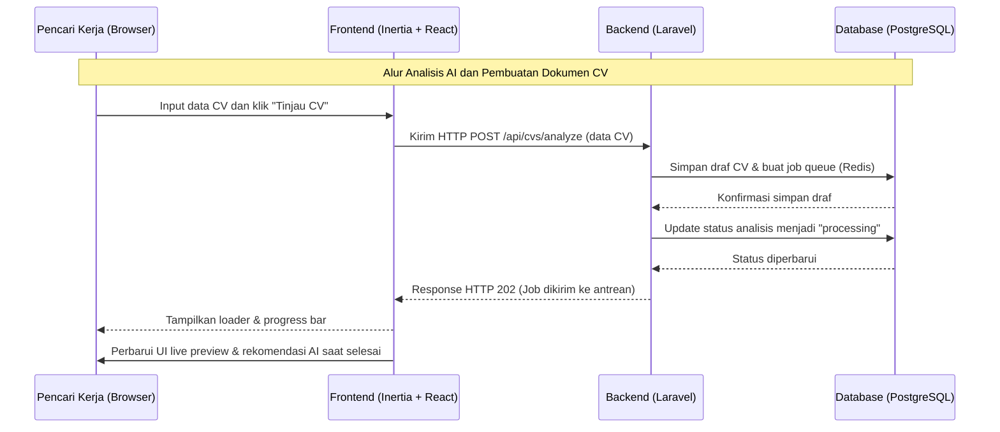
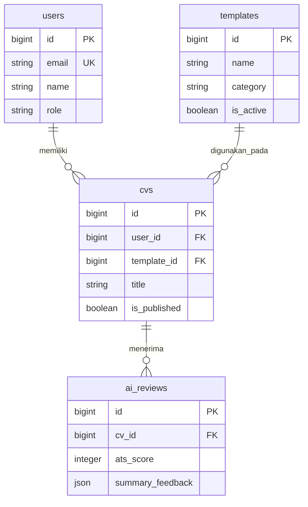

# PRD — Project Requirements Document

**Informasi Dokumen**
- **Nama Produk:** Pembuat Dan Peninjau Cv
- **Versi Dokumen:** v1.0
- **Status:** Draft
- **Tanggal Dibuat:** 2026-09-21
- **Tanggal Update Terakhir:** 2026-09-21
- **Penulis:** Demo User

---

## 1. Overview
Banyak pencari kerja menghadapi tantangan dalam menyusun Resume / Curriculum Vitae (CV) yang sesuai dengan standar *Applicant Tracking System* (ATS) dan relevan dengan posisi yang dilamar. Penyusunan CV secara manual sering kali memakan waktu lama, berisiko kesalahan format, serta minim masukan obyektif terkait kualitas konten. Di sisi lain, alat komersial yang ada sering menetapkan tarif tinggi dan kurang fleksibel dalam hal privasi data pribadi.

"Pembuat Dan Peninjau Cv" hadir sebagai aplikasi berbasis web yang menggabungkan *CV builder* berbasis *real-time preview* dengan modul kecerdasan buatan (*AI Reviewer*) untuk menganalisis kekompatibelan CV terhadap deskripsi pekerjaan. Aplikasi ini dirancang untuk memberikan kemudahan bagi pencari kerja dalam membuat, menyesuaikan, menganalisis, dan mengekspor CV profesional secara efisien dan aman.

Aplikasi ini melayani dua peran utama: **Pencari Kerja** (pengguna akhir yang membuat dan meninjau CV) dan **Admin** (pengelola template, sistem prompt AI, dan pemantau kuota/kinerja sistem). *Value proposition* utama aplikasi ini adalah antarmuka pembuatan CV yang responsif, analisis ATS instan berbasis AI, serta kendali privasi data yang kuat.

---

## 2. Requirements
Berikut adalah persyaratan tingkat tinggi untuk pengembangan sistem:
- **Aksesibilitas:** Platform berbasis Web yang dioptimalkan untuk perangkat desktop (browser modern) pada mode penyuntingan CV, serta responsif untuk perangkat seluler pada mode pratinjau dan pemutakhiran cepat.
- **Pengguna:** 2 Peran utama:
  1. *Pencari Kerja (End-User):* Mengelola profil pribadi, membuat CV, menggunakan bantuan AI untuk ulasan ATS, dan mengunduh file PDF/membagikan tautan.
  2. *Admin:* Mengelola koleksi template CV, mengonfigurasi *prompt* AI dan penyedia API, serta memantau penggunaan sistem.
- **Data Input:** Pengisian formulir terstruktur secara manual, penarikan data dari CV lama (import format PDF/DOCX), dan *paste* deskripsi lowongan kerja (Job Description) untuk tailoring.
- **Spesifisitas Data:** Struktur data CV terstandar (Pengalaman Kerja, Pendidikan, Keahlian, Sertifikasi, Proyek, Informasi Kontak), Skor ATS (0-100), Riwayat Analisis AI, dan URL publik terproteksi.
- **Notifikasi:** *Toast notification* langsung di antarmuka web untuk respon instan, serta bilah kemajuan (*progress bar*) untuk proses berdurasi panjang seperti ekspor PDF dan pemrosesan AI.
- **Keamanan & Keandalan:** Enkripsi data PII (*Personally Identifiable Information*) pada database *at-rest*, transmisi aman HTTPS (TLS 1.3), opsi penyembunyian kontak publik, serta pencapaian ketersediaan (*uptime*) minimal 99.5% di lingkungan VPS.
- **Performansi & Skala:** Pemrosesan ekspor PDF maksimal 3–5 detik via *Laravel Queue* (Redis Worker), dan waktu respons *live preview* penyunting di bawah 100ms.

---

## 3. Core Features
Fitur-fitur kunci yang harus ada dalam versi pertama (MVP):

1.  **Editor CV Interaktif & Live Preview**
    - Editor berbasis formulir terstruktur (Pengalaman, Pendidikan, Keahlian, Profil) yang langsung memperbarui visual rendering CV di sebelah penyunting dengan kinerjanya di bawah 100ms.
    - Pemilihan layout dan pengaturan urutan seksi secara dinamis dengan dukungan pustaka komponen shadcn/ui.
2.  **AI CV Reviewer & ATS Optimizer**
    - Pemindaian otomatis skor keterbacaan ATS dan kesesuaian kata kunci terhadap deskripsi pekerjaan yang diinput pengguna.
    - Rekomendasi perbaikan struktur kalimat deskripsi pekerjaan (*bullet points*) berbasis kata kerja aksi (*action verbs*).
3.  **Ekspor PDF & Manajemen Template**
    - Ekspor dokumen ke format PDF resolusi tinggi dalam waktu 3–5 detik memanfaatkan pengolahan latar belakang *Laravel Queue* berbasis Redis.
    - Penyediaan berbagai pilihan template CV profesional yang terformat rapi dan bebas dari elemen penulisan berlebih.
4.  **Manajemen Tautan Publik & Privasi Data**
    - Fitur berbagi dokumen via tautan URL publik yang dilengkapi proteksi kata sandi opsional.
    - Fitur toggle menyembunyikan kontak sensitif (email dan nomor HP) serta proteksi indeksasi mesin pencari (*meta noindex*).
5.  **Admin Dashboard & Pengaturan AI Provider**
    - Manajemen koleksi template (tambah, edit, nonaktifkan template visual).
    - Monitoring penggunaan API AI, manajemen *prompt template*, serta konfigurasi fallback *multi-provider* untuk menjamin ketersediaan AI tanpa batasan kuota.

---

## 4. User Flow
Alur kerja sederhana bagi **Pencari Kerja** saat menggunakan aplikasi:

1.  **Login / Entry:** Pengguna membuka platform web, melakukan autentikasi (login/register), dan masuk ke halaman Dashboard Utama.
2.  **Setup Data CV:** Pengguna memilih untuk membuat CV baru dari draf kosong, memilih dari template master, atau mengunggah CV lama untuk diekstrak.
3.  **Pengisian & Live Preview Editor:** Pengguna mengisi atau memperbarui data riwayat karir pada bagian penyunting; antarmuka secara instan memperbarui tampilan visual CV di panel pratinjau.
4.  **Aksi Inti (Analisis AI & Tailoring):**
    - *Varian Analisis ATS:* Pengguna menekan tombol "Tinjau CV", sistem mengirimkan konten ke layanan AI untuk memperoleh skor ATS dan rekomendasi perbaikan.
    - *Varian Tailoring Lowongan:* Pengguna memuat deskripsi lowongan kerja tertentu, AI menyarankankan kata kunci yang perlu ditambahkan ke dalam CV.
5.  **Verifikasi & Hasil (Export / Share):** Pengguna meninjau masukan AI, menerapkan saran perbaikan, lalu mengekspor dokumen ke format PDF atau mengaktifkan tautan publik dengan proteksi privasi.

---

## 5. Architecture
Berikut adalah gambaran arsitektur sistem dan aliran data secara teknis:

---

## 6. Database Schema

Ringkasan skema data MVP (versi sederhana). Detail lengkap (tipe data spesifik, indeks, dan batasan cascading) dikelola pada file `db_diagram.md`.

### Ringkasan Tabel

| Tabel | Deskripsi |
|-------|-----------|
| **users** | Memuat akun pengguna: autentikasi, nama, email, dan peran (Pencari Kerja / Admin). |
| **templates** | Memuat direktori template layout CV yang tersedia di platform. |
| **cvs** | Memuat dokumen CV utama milik pengguna, konfigurasi privasi, dan pilihan template. |
| **ai_reviews** | Memuat riwayat ulasan AI, skor ATS, serta rekomendasi perbaikan per revisi CV. |

### Relasi & Cardinality

| Dari | Ke | Kardinalitas | Keterangan |
|------|-----|--------------|------------|
| users | cvs | 1 : N | Satu pengguna dapat membuat dan mengelola banyak dokumen CV |
| templates | cvs | 1 : N | Satu template visual dapat digunakan oleh banyak dokumen CV |
| cvs | ai_reviews | 1 : N | Satu dokumen CV dapat memiliki banyak riwayat ulasan AI |

---

## 7. Design & Technical Constraints
Bagian ini mengatur batasan teknis dan panduan desain yang harus dipatuhi selama pengembangan:

1.  **High-Level Technology:**
    - **Platform:** Aplikasi Website berbasis Monolith Modern.
    - **Frontend:** Inertia.js digabungkan dengan React dan pustaka komponen shadcn/ui untuk memastikan antarmuka yang reaktif dan konsisten.
    - **Backend:** Laravel sebagai penangan logika bisnis, otorisasi, pemrosesan antrean latar belakang (*Laravel Queue* berbasis Redis), serta integrasi AI API.
    - **Database:** PostgreSQL untuk penyimpanan data terstruktur dengan enkripsi data sensitif *at-rest*.
    - **Deployment:** Lingkungan VPS (Virtual Private Server) terkonfigurasi dengan Nginx, Supervisor untuk Redis Workers, dan sertifikat HTTPS (TLS 1.3).

2.  **Typography Rules:**
    Sistem antarmuka (UI) wajib menggunakan konfigurasi font variable sebagai berikut untuk menjaga konsistensi visual:
    - **Sans:** `Inter, system-ui, -apple-system, BlinkMacSystemFont, sans-serif`
    - **Serif:** `Merriweather, Georgia, serif`
    - **Mono:** `JetBrains Mono, Fira Code, monospace`